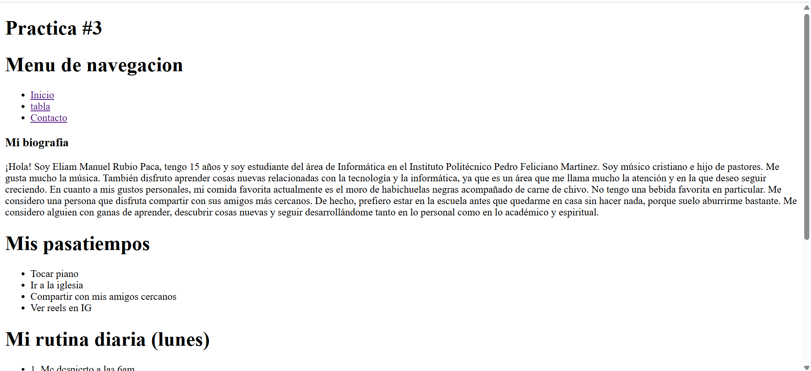
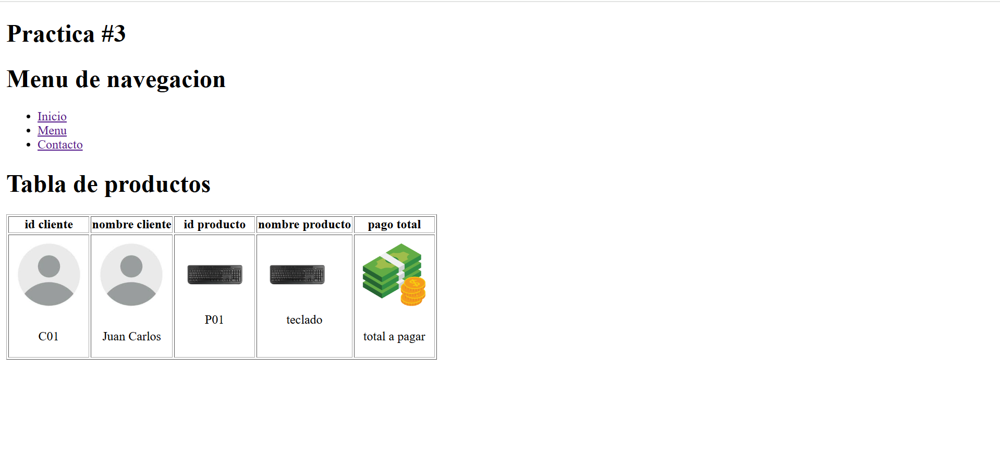
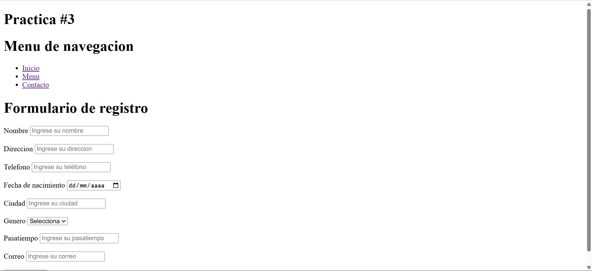

# Sitio Web

## Datos del autor

- **Nombre:** Eliam Manuel Rubio Paca
- **Curso / Sección:** 4to D1 - Informática
- **Asignatura:** Diseño de Portales Web
- **Profesor:** Gamalier Reyes

## Descripción del sitio web

bueno esta practica fue realizada en visual studio tiene inicio tabla y contacto su tabla esta relacionada a un cliente y en el inicio hay una autobiografia mia

## Capturas de pantalla

### 1. Página de inicio

### 2. Página de tabla

### 3. Página de contacto
